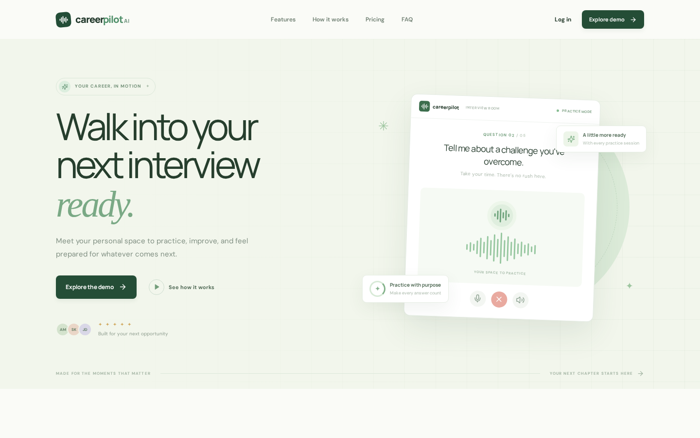
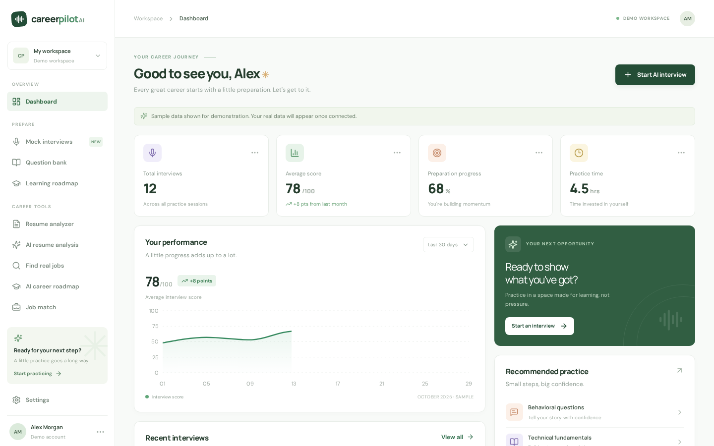
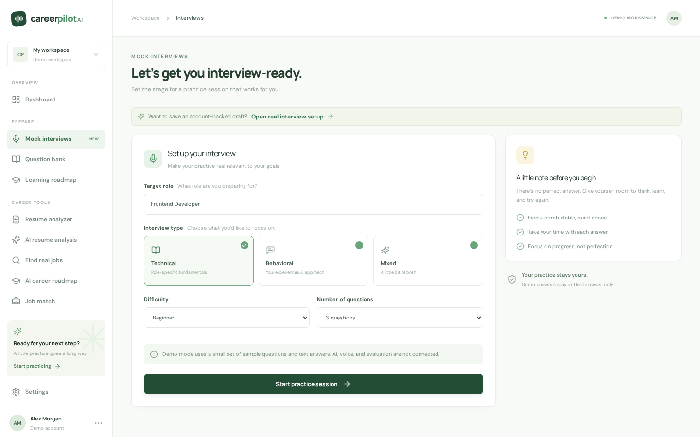
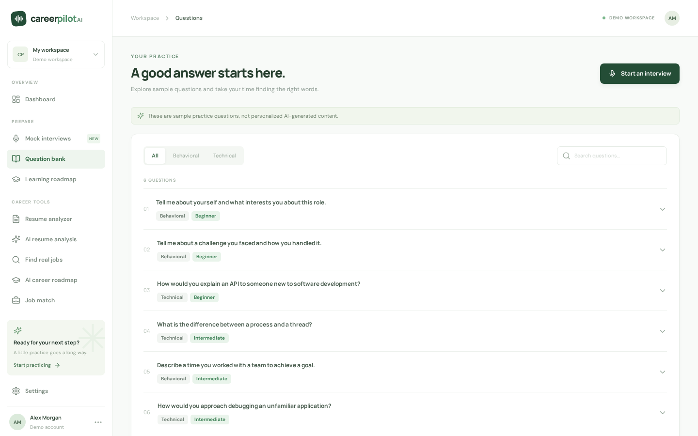
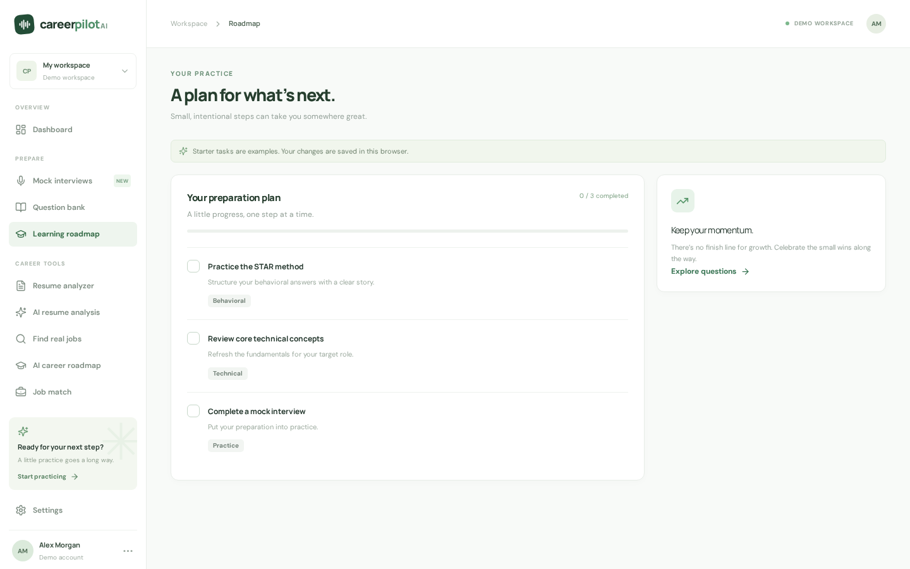
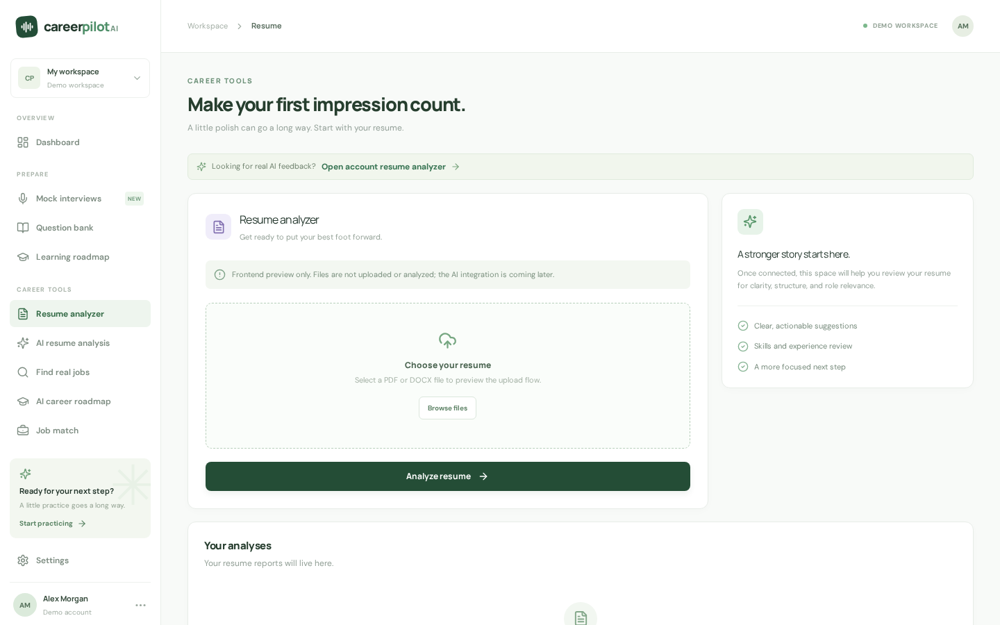

<div align="center">

# 🚀 CareerPilot AI

### Practice with purpose. Build your career with confidence.

An AI-powered career preparation platform for practicing interviews, improving your resume, exploring jobs, and planning your next steps—all in one place.

[🌐 Open the live app](https://careerpilot-ai-1-opig.onrender.com) · [✨ Features](#-features) · [🛠️ Getting started](#-getting-started) · [🚀 Deployment](#-deployment)


</div>

---

## 👋 About the project

CareerPilot AI brings several career-preparation tools together in a single, responsive application. Whether you're practicing an interview, reviewing your resume, looking at job opportunities, or organizing a learning plan, the goal is to help you take the next step with more clarity.

> **Note:** AI-generated feedback is guidance, not a guarantee of interview success, job selection, or career outcomes. Always review recommendations and verify job details independently.

## ✨ Features

| Feature | What you can do |
| --- | --- |
| 🎯 **AI interview practice** | Create an interview, answer questions, and receive AI-generated feedback and a report. |
| 🎙️ **Voice interviews** | Listen to questions and use browser speech recognition to create an editable answer transcript, with typing as a fallback. |
| 📄 **Resume analysis** | Upload a resume for AI-assisted analysis and suggestions. |
| 💼 **Job exploration** | Browse available job listings, save jobs, and explore AI-assisted matching. Demo listings are labeled as such. |
| 🗺️ **Career roadmap** | Generate a personalized learning roadmap and track task progress. |
| 📊 **Account dashboard** | View your own career activity and progress after signing in. |
| 👤 **Profile & authentication** | Sign up, sign in, manage your profile, and sign out. |
| 🧭 **Guest demo** | Explore the separate demo experience without mixing demo activity with your account data. |
| 📱 **Responsive interface** | Use the application across desktop and mobile screen sizes. |

Voice features depend on browser and device support, microphone permissions, and network availability. Some browsers may send audio to a browser-provider speech service; the app sends submitted transcripts to Gemini for evaluation.

## 📸 A look inside CareerPilot AI

A peek at the live website and its **guest demo workspace**. Names, scores, questions, and progress shown in the demo are sample data; the demo resume page is a preview, not the account-backed AI analyzer.

| Home | Demo dashboard |
| :---: | :---: |
|  |  |
| **Interview setup** | **Question bank** |
|  |  |
| **Learning roadmap** | **Resume preview** |
|  |  |

[Explore CareerPilot AI →](https://careerpilot-ai-1-opig.onrender.com)

## 🛠️ Tech stack

**Frontend:** React, TypeScript, Vite, Tailwind CSS, React Router, Recharts, Lucide icons  
**Backend:** Python, FastAPI, SQLAlchemy, Alembic  
**Database:** PostgreSQL / Neon  
**AI:** Google Gemini API  
**Deployment:** Render Static Site + Render Web Service

## 🏗️ Project structure

```text
careerpilot-ai/
├── backend/              # FastAPI application, migrations, and backend tests
├── public/               # Public frontend assets and redirects
├── src/
│   ├── features/         # Auth, dashboard, interviews, jobs, resume, roadmap, etc.
│   ├── main.tsx          # Application shell and routes
│   └── style.css         # Application styling and responsive layouts
├── tests/                # Frontend and end-to-end tests
├── index.html
├── package.json
├── render.yaml
└── README.md
```

## 🚀 Getting started

### Prerequisites

- Node.js and npm
- Python 3.10+ and pip
- A PostgreSQL database, such as Neon or a local instance
- A Gemini API key for AI-powered features

### 1. Clone the repository

```bash
git clone https://github.com/Jaypatel-26/careerpilot-ai.git
cd careerpilot-ai
```

### 2. Set up the backend

```bash
cd backend
python3 -m venv .venv
source .venv/bin/activate
# Windows PowerShell: .venv\Scripts\Activate.ps1
pip install -r requirements.txt
cp .env.example .env
```

Edit `backend/.env` with your own configuration:

- `DATABASE_URL` — your PostgreSQL connection URL. For Neon, use its provided connection string and TLS settings.
- `MIGRATION_DATABASE_URL` — optional direct connection to the same database for migrations.
- `JWT_SECRET_KEY` — a strong, private signing secret. Generate one with `python -c "import secrets; print(secrets.token_urlsafe(48))"`.
- `CORS_ALLOWED_ORIGINS` — the exact frontend origin(s), comma-separated, without trailing slashes.
- `GEMINI_API_KEY` and `GEMINI_MODEL` — server-side Gemini configuration.
- `GREENHOUSE_BOARD_TOKENS` — public employer board tokens for the optional Greenhouse jobs feed.

See [`backend/.env.example`](backend/.env.example) for the complete example. Never commit your `.env` file or share credentials.

From the `backend` directory, apply migrations and start the API:

```bash
alembic upgrade head
uvicorn app.main:app --reload --host 127.0.0.1 --port 8000
```

API documentation is available locally at [http://127.0.0.1:8000/docs](http://127.0.0.1:8000/docs).

### 3. Set up the frontend

Open a new terminal in the repository root:

```bash
cp .env.example .env
npm ci
npm run dev
```

Open [http://localhost:5173](http://localhost:5173). The default local API path is `/api/v1`; Vite proxies requests to the local backend. See [`.env.example`](.env.example) for frontend configuration.

## 🚀 Deployment

The frontend and backend are deployed as separate Render services from the same repository.

### Frontend — Static Site

| Setting | Value |
| --- | --- |
| Root Directory | Leave blank (repository root) |
| Build Command | `npm ci && npm run build` |
| Publish Directory | `dist` |
| Environment | `VITE_API_BASE_URL` = your backend HTTPS URL followed by `/api/v1` |

Configure a rewrite from `/*` to `/index.html` with status `200` so direct visits to frontend routes work.

### Backend — Web Service

| Setting | Value |
| --- | --- |
| Root Directory | `backend` |
| Build Command | `pip install -r requirements.txt` |
| Start Command | `alembic upgrade head && uvicorn app.main:app --host 0.0.0.0 --port $PORT` |

Set the backend database, JWT, CORS, and Gemini environment variables in Render. `CORS_ALLOWED_ORIGINS` should include the frontend's exact HTTPS origin. Keep the JWT secret stable between deployments. The included [`render.yaml`](render.yaml) provides a backend service configuration.

> Back up the database before applying migrations. Never put database credentials, JWT secrets, or Gemini API keys in frontend `VITE_` variables. AI features require a correctly configured provider and may use API quota or incur charges.

## 🧪 Testing

```bash
# From the repository root: type-check and build the frontend
npm ci
npm run build

# Backend tests
cd backend
python -m pytest -q
```

End-to-end test scripts are available in [`tests/e2e`](tests/e2e). Automated tests may use mocks and do not replace testing real Gemini requests, job providers, microphone permissions, or deployed services.

## 🔐 Privacy & security notes

- Keep secrets in environment variables, not in source code or public screenshots.
- AI features send the relevant submitted content to Gemini; avoid uploading sensitive information you do not want processed by a third party.
- Voice recognition behavior depends on the browser and its speech service.
- The account-backed features use authentication and user-scoped records; the demo remains separate.
- This project is a prototype. Additional security review, abuse protection, account recovery, monitoring, and backup planning are recommended before production use.

## 📚 More documentation

- [Text interviews](PHASE2.md) · [Voice interviews](PHASE3.md) · [Resume analysis](PHASE4.md)
- [Job matching](PHASE5.md) · [Career roadmap](PHASE6.md)
- [Account dashboard](ACCOUNT_DASHBOARD_FIX.md) · [Mobile update](MOBILE_UPDATE.md)

Some phase documents describe earlier deployment layouts; use the root directories in the deployment section above for the current repository structure.

---

<div align="center">

**Built to make career preparation more focused, accessible, and actionable.**

Made by [Jay Patel](https://github.com/Jaypatel-26)

</div>
